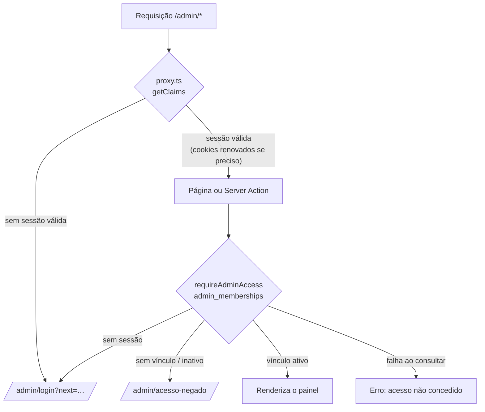

# Autenticação administrativa — GeoLogar

Fundação da área restrita (Etapa 6): login com e-mail e senha pelo Supabase
Auth, autorização por vínculo em `admin_memberships` e painel inicial em
`/admin`. Ainda **não** há edição de conteúdo: as tabelas editoriais continuam
somente leitura para `anon` e `authenticated`.

## Rotas

| Rota                      | Acesso                  | Conteúdo                                                  |
| ------------------------- | ----------------------- | --------------------------------------------------------- |
| `/admin/login`            | público                 | Login (redireciona para `/admin` se já houver acesso)     |
| `/admin/recuperar-senha`  | público                 | Solicitação do link de redefinição (resposta neutra)      |
| `/auth/callback`          | público                 | Retorno dos links de e-mail (`code` ou `token_hash`)      |
| `/admin/nova-senha`       | sessão válida           | Definição de nova senha (após o link ou pelo perfil)      |
| `/admin/acesso-negado`    | sessão válida           | Conta autenticada sem vínculo ativo                       |
| `/admin`                  | vínculo ativo           | Visão geral: contagens reais do conteúdo publicado        |
| `/admin/homepage`         | vínculo ativo           | CMS: edição da homepage (ver [`cms.md`](cms.md))           |
| `/admin/linhas-de-pesquisa` (+ `/novo`, `/[id]/editar`) | vínculo ativo | CMS: linhas de pesquisa; excluir só `admin` |
| `/admin/projetos` (+ `/novo`, `/[id]/editar`) | vínculo ativo | CMS: projetos e vínculos com linhas; excluir só `admin` |
| `/admin/perfil`           | vínculo ativo           | E-mail, papel e identificador da conta                    |

O rodapé do site tem um link discreto "Área restrita" para `/admin/login`.
Todas as páginas de `/admin` têm `robots: noindex, nofollow`.

## Arquitetura

```
src/proxy.ts                      Sessão: getClaims(), renovação de cookies, redireciono sem sessão
src/lib/supabase/cookies.ts       Opções dos cookies de sessão (httpOnly, secure, sameSite)
src/lib/auth/access.ts            resolveAdminAccess / getAdminAccess / requireAdminAccess
src/lib/auth/actions.ts           Server Actions: signIn, signOut, requestPasswordReset, updatePassword
src/lib/auth/redirect.ts          Destinos e origens permitidos (sem open redirect)
src/app/auth/callback/route.ts    exchangeCodeForSession / verifyOtp
src/app/(public)/                 Site público (layout com Header e Footer)
src/app/admin/(auth)/             Login, recuperação, nova senha, acesso negado
src/app/admin/(protected)/        Painel: layout com barra lateral + páginas
src/components/admin/             AdminShell, AdminNavigation, AuthCard, formulários
src/data/admin-navigation.ts      Módulos do painel ("Em breve" = sem link)
```

O layout raiz (`src/app/layout.tsx`) contém apenas `html`, `body`, fontes e
CSS global. O cabeçalho e o rodapé do site ficam no grupo `(public)` — os
grupos entre parênteses não alteram as URLs.



### Por que a verificação fica em cada página

O proxy apenas renova a sessão e barra visitantes sem login; ele **não**
decide permissões. Layouts não são renderizados de novo a cada navegação
e não bloqueiam a página, por isso `requireAdminAccess()` é chamada em toda
página protegida (o layout também chama, para obter e-mail e papel). Toda
Server Action futura da área administrativa deve começar por
`requireAdminAccess()`.

## Sessão e cookies

- Identidade: `supabase.auth.getClaims()` valida o JWT do cookie (assinatura e
  expiração) e renova a sessão quando o access token está para expirar.
  `getSession()` não é usado como prova de identidade, e `user_metadata` é
  ignorado.
- O proxy roda apenas em `/admin` e `/admin/:path*` (`matcher`); o site público
  não passa por ele.
- Cookies `sb-<projeto>-auth-token*`: `HttpOnly`, `Secure` em produção,
  `SameSite=Lax`, `Path=/`. A validade é a padrão do `@supabase/ssr`; a sessão
  em si expira conforme o access token (1 h) e o refresh token do projeto.
- Respostas de `/admin` e `/auth/callback` saem com
  `Cache-Control: private, no-store`; páginas administrativas nunca vão para
  cache compartilhado e o botão Voltar não reexibe uma página após o logout.
- O Next.js 16 executa o `proxy.ts` no runtime Node.js. No Cloudflare, o
  OpenNext marca esse modo como **experimental** (aviso no build). Ele foi
  validado no `npm run preview` (workerd) e deve ser conferido a cada
  atualização do OpenNext ou do Next.js.

## Autorização

Tabela `public.admin_memberships` (detalhes em
[`database-schema.md`](database-schema.md#admin_memberships)):

| Papel    | Rótulo         | Uso previsto                                   |
| -------- | -------------- | ---------------------------------------------- |
| `admin`  | Administrador  | Gestão completa (inclusive futuros usuários)   |
| `editor` | Editor         | Edição de conteúdo nas próximas etapas         |

- RLS: o usuário autenticado lê **apenas o próprio** registro; não há políticas
  de escrita, e `anon`/`authenticated` não têm `INSERT`, `UPDATE` ou `DELETE`.
  Ninguém se promove pela aplicação.
- O vínculo é consultado a cada requisição: remover ou desativar
  (`is_active = false`) vale a partir da requisição seguinte.
- Uma falha na consulta gera erro (página "Não foi possível carregar o
  painel"); o acesso nunca é concedido por falha.
- A chave secreta (`service_role`) não é usada para autorização nem para as
  contagens do painel, que usam a sessão do próprio usuário e o RLS público.

## Login, logout e mensagens

- Mensagem única para credenciais inválidas ("E-mail ou senha incorretos."),
  sem indicar se a conta existe. Falha de conexão e excesso de tentativas
  (limite do Supabase) têm mensagens próprias.
- O botão fica desabilitado durante o envio (sem envio duplicado).
- `next` só aceita caminhos internos de `/admin` (`safeAdminPath`); qualquer
  outro valor (URL externa, `//`, `..`, query) cai em `/admin`.
- Logout: `signOut({ scope: "local" })` encerra a sessão deste navegador,
  apaga os cookies e redireciona para `/admin/login?saida=1`.
- O proxy não redireciona requisições de Server Action (`POST` com cabeçalho
  `Next-Action`): cada action verifica a sessão e responde com erro
  estruturado, o que permite ao formulário manter o texto quando a sessão
  expira.
- Server Actions só aceitam `POST` da mesma origem (proteção do Next.js
  contra CSRF); os cookies `SameSite=Lax` não são enviados em `POST` de
  outros sites.

## Recuperação de senha

1. `/admin/recuperar-senha` chama `resetPasswordForEmail` com
   `redirectTo = <origem>/auth/callback?next=/admin/nova-senha`. A resposta é
   sempre neutra ("Se houver uma conta…").
2. A origem vem do cabeçalho `Origin` **somente** se estiver na lista de
   `src/lib/auth/redirect.ts` (produção, `localhost:3000`, `localhost:8787`);
   caso contrário, usa a URL de produção. O Supabase também valida o destino
   contra as Redirect URLs do projeto.
3. `/auth/callback` troca o `code` pela sessão (PKCE) e envia para
   `/admin/nova-senha`; link inválido, expirado ou já usado leva a
   `/admin/login?erro=link-invalido`.
4. Após salvar a nova senha, a sessão é encerrada e o usuário entra de novo.

Limitação do PKCE: o link precisa ser aberto **no mesmo navegador** em que foi
solicitado (o verificador fica em um cookie). Para links que funcionem em
qualquer navegador, personalize os modelos de e-mail para usar `token_hash`
(a rota já aceita `recovery`, `invite` e `email`):

```
{{ .SiteURL }}/auth/callback?token_hash={{ .TokenHash }}&type=recovery&next=/admin/nova-senha
{{ .SiteURL }}/auth/callback?token_hash={{ .TokenHash }}&type=invite&next=/admin/nova-senha
```

Tokens e códigos nunca são registrados em log: os logs de autenticação
contêm apenas o código do erro.

## Configuração do Supabase (painel)

Verifique cada item antes de alterar; nenhuma destas configurações remotas foi
alterada pelo código.

**Authentication → URL Configuration**

- Site URL: `https://geologar.plataformageologar.workers.dev`
- Redirect URLs:
  - `https://geologar.plataformageologar.workers.dev/auth/callback`
  - `http://localhost:3000/auth/callback`
  - `http://localhost:8787/auth/callback` (opcional, para `npm run preview`)

**Authentication → Sign In / Providers**

- Somente **Email** habilitado; OAuth, telefone e login anônimo desativados.
- **Desativar o cadastro público**: desligue *Allow new users to sign up*
  (equivale a `enable_signup = false`). Usuários existentes continuam entrando;
  convites pelo painel continuam funcionando. Em 03/11/2026 o projeto ainda
  estava com o cadastro **habilitado** (`disable_signup: false` em
  `/auth/v1/settings`) — sem página de cadastro no site, mas a API aceitaria
  `signUp`. Uma conta criada assim não tem vínculo e cai em "acesso negado".
- Mantenha a confirmação de e-mail ativa e, de preferência, senha mínima de
  8 caracteres (a aplicação exige 8 ao definir nova senha).

**E-mails**

O serviço de e-mail padrão do Supabase tem limite baixo de envios por hora e
é destinado a testes. Para produção, configure um SMTP próprio em
*Authentication → Emails → SMTP Settings* e revise os modelos de convite e
recuperação.

O ambiente local (`supabase/config.toml`) já usa `enable_signup = false`,
`site_url = "http://localhost:3000"` e a Redirect URL local.

## Criar o primeiro administrador

Não existe usuário padrão nem credencial de demonstração. Para criar o primeiro
acesso:

1. No painel do Supabase, *Authentication → Users → Add user*: escolha
   **Send invitation** (o convidado define a própria senha) ou **Create new
   user** com uma senha forte informada diretamente à pessoa.
2. Copie o **User UID** do usuário criado.
3. Em *SQL Editor*, vincule o usuário (substitua o marcador):

   ```sql
   insert into public.admin_memberships (user_id, role)
   values ('<UUID-DO-USUARIO>', 'admin');
   ```

4. Confira:

   ```sql
   select user_id, role, is_active, created_at
   from public.admin_memberships;
   ```

5. Acesse `/admin/login` com o e-mail e a senha da conta.

Para outros papéis use `'editor'`. Para revogar o acesso sem apagar a conta:

```sql
update public.admin_memberships set is_active = false where user_id = '<UUID-DO-USUARIO>';
```

Nunca coloque UUIDs, e-mails ou senhas reais em migrations ou no repositório.

## Testes manuais

| Cenário | Passos | Esperado |
| ------- | ------ | -------- |
| A — anônimo | Abrir `/admin`, `/admin/perfil` | `307` para `/admin/login` (com `next`), `Cache-Control: private, no-store` |
| B — login inválido | Senha errada | "E-mail ou senha incorretos.", sem revelar se a conta existe |
| C — sem vínculo | Entrar com conta sem `admin_memberships` | `/admin/acesso-negado` com "Sair desta conta" |
| D — administrador | Entrar com vínculo ativo | `/admin` com e-mail, papel e contagens; `/admin/perfil` |
| E — desativado | `is_active = false` com a sessão aberta | Próxima navegação leva a `/admin/acesso-negado` ("desativado") |
| F — sessão expirada | Cookie com sessão vencida ou inválida | Cookies apagados e redirecionamento para o login |
| G — recuperação | Solicitar link, abrir no mesmo navegador, definir senha | `/admin/nova-senha` → login com "Senha redefinida" |
| Logout | "Sair" e depois Voltar | Login; páginas anteriores não reaparecem autenticadas |
