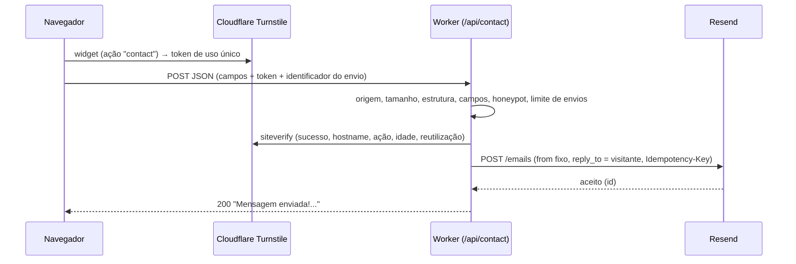

# Formulário de contato (Etapa 9) — DESATIVADO

> **Situação em 25/11/2026: desativado por decisão de escopo.** O briefing
> trata o formulário como **opcional**. A GeoLogar optou por divulgar
> **canais diretos** (e-mail, telefone, WhatsApp, endereço e redes sociais)
> na coluna **Contato do rodapé**, presente em todas as páginas
> (âncora `#contato`). Resend e Cloudflare Turnstile **não são requisitos**
> do portal. Os dados de contato serão fornecidos pela equipe GeoLogar e
> cadastrados pelo CMS. O formulário pode ser reavaliado no futuro.

## Situação atual

| Item | Situação |
|---|---|
| Página `/contato` | Removida. A rota redireciona (`307`) para `/#contato`; não responde 404 e saiu do `sitemap.xml`. |
| Formulário, Turnstile e JavaScript do formulário | Não são renderizados nem carregados em nenhuma página (não é só CSS). |
| `POST /api/contact` | Responde `404` com `Cache-Control: no-store`, **sem ler variáveis de ambiente**, sem chamar o Turnstile ou o Resend e sem ler o corpo da requisição. |
| `CONTACT_FORM_ENABLED` e demais variáveis | **Sem efeito**: nenhum código em execução as lê. Cadastrar `CONTACT_FORM_ENABLED=true` por engano não exibe nem envia nada. |
| Binding `CONTACT_RATE_LIMITER` | Removido do `wrangler.jsonc`. |
| Código preservado | `src/lib/contact/*` (validação, Turnstile, Resend, limite de envios), `src/components/contact/*` e os testes de `tests/contact/` continuam no repositório e rodam em `npm test`. |
| Contato no site | Coluna “Contato” do rodapé, editável em *Configurações* e no editor visual (ver [`cms.md`](cms.md#informações-institucionais-adminconfiguracoes)). |

### Como reativar (somente com nova decisão da GeoLogar)

A reativação é uma mudança de código, revisada e publicada como qualquer
outra — não basta cadastrar variáveis:

1. Recuperar do histórico do Git (commit anterior a "refactor: simplify
   institutional contact and consolidate footer channels") a página
   `src/app/(public)/contato/page.tsx`, a rota `src/app/api/contact/route.ts`
   original e o bloco `ratelimits` do `wrangler.jsonc` (reproduzido abaixo).
2. Decidir o destino de `/contato` (remover o redirecionamento de
   `next.config.ts`) e devolver a página ao `sitemap.xml`.
3. Seguir o [checklist de ativação](#checklist-de-ativação).

```jsonc
"ratelimits": [
  { "name": "CONTACT_RATE_LIMITER", "namespace_id": "1001", "simple": { "limit": 5, "period": 60 } }
]
```

O restante deste documento descreve o formulário como foi implementado
(referência para uma reativação).

## Implementação original

Formulário em `/contato` que enviava a mensagem do visitante por e-mail para a
equipe GeoLogar. **Nenhuma mensagem era gravada no banco**: não há tabela,
painel de mensagens, CRM nem anexos. Implementado e testado em 19/11/2026
com chaves de teste e provedor simulado; nunca foi ativado em produção e
nenhum envio real foi feito.

## Visão geral



| Parte | Arquivo |
|---|---|
| Página (formulário + canais) | `src/app/(public)/contato/page.tsx` |
| Formulário (cliente) | `src/components/contact/contact-form.tsx` |
| Widget Turnstile | `src/components/contact/turnstile-widget.tsx` |
| Rota | `src/app/api/contact/route.ts` |
| Fluxo do servidor | `src/lib/contact/handler.ts` |
| Validação e limites (navegador e servidor) | `src/lib/contact/schema.ts` |
| Configuração (variáveis de runtime) | `src/lib/contact/config.ts` |
| Turnstile (siteverify) | `src/lib/contact/turnstile.ts` |
| E-mail (Resend via `fetch`) | `src/lib/contact/email.ts` |
| Limite de envios (binding) | `src/lib/contact/rate-limit.ts` + `wrangler.jsonc` |
| Mensagens ao visitante | `src/lib/contact/messages.ts` |
| Testes | `tests/contact/*.test.ts` (`npm test`) |

Foi usada uma **Route Handler** (e não Server Action) para controlar
diretamente o tamanho do corpo, o tipo de conteúdo, a origem e o formato JSON
estrito. O Resend é chamado com `fetch` (sem SDK), compatível com o Workers.

## Campos

| Campo | Regra |
|---|---|
| Nome | obrigatório, até 120 caracteres, sem caracteres de controle/quebras |
| E-mail | obrigatório, até 254 caracteres, formato `nome@dominio.tld` |
| Assunto | obrigatório, um destes: Informações sobre a GeoLogar; Pesquisa e projetos; Cooperação institucional; Publicações científicas; Outros assuntos |
| Mensagem | obrigatória, até 5.000 caracteres; quebras de linha preservadas |

As mesmas regras rodam no navegador (antes do envio) e no servidor. O
servidor também recusa: chaves a mais ou a menos no JSON, valores que não
sejam texto, identificador de envio fora do formato UUID, corpo acima de
32 KB (com ou sem `Content-Length`), conteúdo que não seja
`application/json`, requisições sem `Origin` da própria página (ou com
`Sec-Fetch-Site` diferente de `same-origin`) e o campo-armadilha preenchido.
Destinatário, remetente e `reply_to` nunca vêm do navegador.

## Variáveis

Todas são lidas **em tempo de execução** (variáveis do Worker). Sem qualquer
uma delas, ou sem `CONTACT_FORM_ENABLED=true`, a página mostra apenas os
canais publicados — o formulário não aparece e `/api/contact` responde `503`.

| Variável | Tipo no Cloudflare | Conteúdo |
|---|---|---|
| `CONTACT_FORM_ENABLED` | Text | `true` para ativar; qualquer outro valor desativa |
| `CONTACT_TO_EMAIL` | Text | Destinatário definido pela GeoLogar (até 5, separados por vírgula). **Não** vem de `site_settings.contact_email` |
| `CONTACT_FROM_EMAIL` | Text | Remetente em domínio verificado no Resend, ex.: `GeoLogar <nao-responda@DOMINIO-VERIFICADO>` |
| `NEXT_PUBLIC_TURNSTILE_SITE_KEY` | Text | Chave pública do widget (lida no servidor e entregue à página) |
| `RESEND_API_KEY` | **Secret** | Chave da API do Resend (permissão só de envio) |
| `TURNSTILE_SECRET_KEY` | **Secret** | Chave secreta do widget Turnstile |

- Cadastro: *Workers & Pages → geologar → Settings → Variables and Secrets*
  (variáveis de **runtime**, não de build). `keep_vars: true` no
  `wrangler.jsonc` mantém os valores a cada deploy. Alternativa por linha de
  comando: `npx wrangler secret put RESEND_API_KEY`.
- **Nunca** coloque `RESEND_API_KEY` ou `TURNSTILE_SECRET_KEY` em `.env*`: o
  build do OpenNext embute esses arquivos no Worker.
  `scripts/assert-no-secret-env.mjs` bloqueia `npm run deploy`/`upload` se
  encontrar essas chaves (ou `SUPABASE_SECRET_KEY`) em `.env*`.
- Nenhuma credencial vai para `wrangler.jsonc`, para o Git ou para variáveis
  `NEXT_PUBLIC_*` (a única pública é a chave do widget, que é pública por
  natureza).

## Turnstile

- Widget em modo explícito (`render=explicit`), ação `contact`, idioma
  `pt-br`, tema claro, largura flexível, renovação automática do token
  expirado.
- O servidor valida no
  [siteverify](https://challenges.cloudflare.com/turnstile/v0/siteverify):
  `success`, **hostname** igual ao da requisição, **ação** `contact`,
  **idade** do desafio ≤ 5 min e **reutilização** (`timeout-or-duplicate`).
  Cada token vale uma vez; após qualquer resposta o widget gera outro, então o
  visitante pode tentar de novo.
- Falha: "Não foi possível validar o envio. Tente novamente." (os dados
  digitados permanecem).
- **Hostnames do widget** (painel do Cloudflare → Turnstile): cadastrar
  `geologar.plataformageologar.workers.dev` e, quando existir, o domínio
  oficial. Não é preciso cadastrar `localhost`: os testes locais usam as
  chaves de teste públicas.
- **Chaves de teste**: respondem com hostname fictício e sem ação. São aceitas
  **somente** quando a requisição chega por `localhost`/`127.0.0.1`; publicadas
  por engano, todo envio é recusado (`turnstile-testing-key` no log).
- Não há Content-Security-Policy no projeto; se uma for criada, liberar
  `https://challenges.cloudflare.com` em `script-src` e `frame-src`.

## Proteções adicionais

- **Honeypot**: campo `website` fora da tela, fora da tabulação e oculto de
  leitores de tela. Preenchido → recusa com a mensagem de validação genérica.
- **Limite de envios**: binding de
  [Rate Limiting do Workers](https://developers.cloudflare.com/workers/runtime-apis/bindings/rate-limit/)
  `CONTACT_RATE_LIMITER` (`wrangler.jsonc`): **5 envios por 60 segundos por
  visitante**. A chave é um HMAC-SHA-256 do IP (`cf-connecting-ip`) com uma
  chave derivada do secret do Turnstile — o IP não é guardado nem registrado.
  O contador é do próprio Cloudflare, por localidade e aproximado (não é um
  limite global exato); não usa KV, Durable Objects, Redis nem memória do
  isolate. Só conta requisições que passaram pela validação dos campos. Se o
  binding falhar, o envio segue protegido pelo Turnstile. Excedido:
  "Você enviou várias mensagens em pouco tempo. Aguarde um minuto e tente
  novamente." (HTTP 429). No `next dev` o binding não existe e o limite não
  se aplica.
- **Envio duplo**: o botão ignora cliques enquanto o envio está em andamento
  (três cliques seguidos geram uma única requisição).
- **Idempotência**: o navegador gera um identificador por mensagem (mantido
  até o envio ser aceito). O servidor deriva dele e do conteúdo o cabeçalho
  `Idempotency-Key` do Resend (válido por 24 h): repetir o mesmo envio — por
  exemplo, depois de uma resposta perdida — não gera outro e-mail.
- **Injeção de cabeçalhos**: o assunto vem da lista fixa; nome e e-mail não
  aceitam quebras de linha ou caracteres de controle; a API JSON do Resend
  monta os cabeçalhos. O e-mail do visitante vai só em `reply_to`.

## E-mail enviado

- Assunto: `[GeoLogar] Novo contato: <assunto escolhido>`.
- Corpo em **texto puro** e **HTML simples**, com nome, e-mail, assunto, data
  e hora (horário de Brasília) e a mensagem. No HTML, todo conteúdo do
  visitante é escapado; acentos e quebras de linha são preservados.
- Remetente: `CONTACT_FROM_EMAIL`. Responder ao e-mail responde ao visitante.
- "Mensagem enviada!" aparece só depois que o Resend **aceita** a mensagem
  (HTTP 200 com `id`). Aceite não garante entrega na caixa de entrada
  (filtros de spam, caixa cheia etc.).

## Privacidade e logs

- Nenhum dado do formulário é gravado no banco ou em arquivos.
- Logs (Observability do Worker) são JSON com códigos genéricos, por exemplo
  `{"scope":"contact","event":"contact_rejected","code":"turnstile-invalid-token","status":400}`
  e `{"scope":"contact","event":"contact_sent"}`. Nunca contêm nome, e-mail,
  mensagem, IP, token ou chaves (verificado por teste automatizado e no
  preview local).
- Texto exibido abaixo do formulário: "Os dados informados serão utilizados
  para responder à sua mensagem enviada à GeoLogar." — **pendente de
  validação pela GeoLogar**. Não há política de privacidade publicada e o
  projeto não declara conformidade com a LGPD (ver
  [`content-handover.md`](content-handover.md#jurídico)).
- O Resend processa nome, e-mail e mensagem para entregar o e-mail; a
  retenção no provedor segue a conta da GeoLogar.

### Códigos de log

| Código | Significado |
|---|---|
| `not-configured` | Formulário desativado ou variáveis incompletas/inválidas (503) |
| `origin`, `content-type`, `body-too-large`, `malformed-json`, `malformed-payload` | Requisição fora do formato esperado (403/415/413/400) |
| `validation` | Campos inválidos (422) |
| `honeypot`, `turnstile-missing` | Campo-armadilha preenchido ou envio sem token (400) |
| `rate-limited` | Limite de envios atingido (429) |
| `turnstile-invalid-token`, `turnstile-expired-or-duplicate`, `turnstile-hostname-mismatch`, `turnstile-action-mismatch`, `turnstile-stale`, `turnstile-testing-key` | Token recusado (400) |
| `turnstile-unavailable` | Siteverify fora do ar ou secret inválido (503) |
| `provider-auth` | `RESEND_API_KEY` inválida ou sem permissão (502) |
| `provider-rejected` | Resend recusou (ex.: remetente fora de domínio verificado) (502) |
| `provider-rate-limited`, `provider-unavailable` | Limite ou indisponibilidade do Resend (502) |
| `rate-limit-unavailable` | Binding de limite falhou; envio seguiu com Turnstile |

## Mensagens ao visitante

| Situação | Mensagem |
|---|---|
| Enviando | Enviando mensagem... |
| Sucesso | Mensagem enviada! Entraremos em contato pelo e-mail informado. |
| Campos inválidos | Revise os campos destacados. (+ erro em cada campo) |
| Verificação | Não foi possível validar o envio. Tente novamente. |
| Limite | Você enviou várias mensagens em pouco tempo. Aguarde um minuto e tente novamente. |
| Demais falhas | Não foi possível enviar sua mensagem agora. Tente novamente ou utilize os canais de contato disponíveis. |

Em qualquer erro os dados digitados permanecem no formulário. Acessibilidade:
rótulos visíveis, `aria-required`, `aria-invalid` e `aria-describedby` nos
campos, foco no primeiro campo inválido ou na mensagem de retorno, região
`aria-live` para "Enviando mensagem...", ordem de tabulação natural (o
honeypot fica fora dela) e contador de caracteres.

## Layout

Formulário ativo: duas colunas a partir de 1024 px (formulário e "Outros
canais"), uma coluna abaixo disso. Nome e e-mail ficam lado a lado só quando o
próprio formulário tem ≥ 32 rem (container query). Sem canais publicados, a
coluna lateral mostra o aviso vazio com links para `/rede` e `/pesquisa`.
Formulário inativo: a página fica exatamente como antes (canais ou aviso
vazio).

## Testes

### Automatizados (`npm test`)

51 testes com `node --test` (Node 22, sem dependências) e `fetch` simulado —
nenhuma chamada de rede:

- validação: campos vazios, limites (120/254/5.000, com valores no limite
  aceitos), e-mail inválido, assunto fora da lista, quebras de linha em
  nome/e-mail, caracteres de controle, normalização (CRLF, NFC, acentos);
- payload: chaves extras/ausentes (`to`, `replyTo`, `role`), tipos, UUID,
  token, honeypot;
- configuração: desativada, incompleta, remetente/destinatário inválidos;
- Turnstile: sucesso, token inválido, reutilizado/expirado, hostname, ação,
  idade, chave de teste fora do localhost, siteverify fora do ar, erro de rede;
- e-mail: assunto, escape de HTML, texto puro com acentos e quebras,
  `from`/`to`/`reply_to`, `Idempotency-Key` estável por conteúdo, mapeamento
  dos status 401/403/409/422/429/500 do provedor;
- rota completa: sucesso só após aceite do provedor, idempotência ao repetir,
  503 sem configuração, origem (sem `Origin`, externa, `cross-site`), 415,
  413 (com e sem `Content-Length`), JSON inválido, campos internos
  manipulados, 422 com erros por campo, honeypot e limite **sem** chamadas
  externas, token recusado **sem** chamar o Resend, falha do provedor com
  mensagem genérica, logs sem dados pessoais/tokens/chaves.

### Preview local do Worker (19/11/2026)

`npm run preview` (ou `npx wrangler dev`) com `.dev.vars` contendo as chaves
de teste públicas do Turnstile e uma chave **fictícia** do Resend:

| Cenário | Resultado |
|---|---|
| `GET /api/contact` | 405 |
| Sem `Origin` / `Origin` externa | 403 / 403 |
| `application/x-www-form-urlencoded` | 415 |
| Corpo de 40 KB | 413 |
| JSON inválido / campo extra `to` | 400 / 400 |
| Campos inválidos | 422 com erros por campo |
| Honeypot / sem token | 400 "Não foi possível validar o envio..." |
| Token válido + chave Resend fictícia | 502 (`provider-auth`), mensagem genérica, dados mantidos |
| 6º envio em 60 s | 429 (`rate-limited`) |
| Secret de teste que sempre falha (`2x…`) | 400 (`turnstile-invalid-token`), novo token gerado, dados mantidos |
| `CONTACT_FORM_ENABLED=false` | página sem formulário nem script do Turnstile; API 503 |
| Navegador: envio vazio | erros nos 4 campos, foco em Nome, alerta anunciado |
| Navegador: três cliques seguidos | uma única requisição |
| Navegador: Tab | Nome → E-mail → Assunto → Mensagem → widget → Enviar (honeypot ignorado), foco visível |
| Larguras 375/390/768/1024/1280/1440 | sem rolagem horizontal; 1 coluna até 768, 2 a partir de 1024 |

**Pendente:** envio real (caminho de sucesso com o Resend) e validação do
Turnstile com as chaves reais no domínio publicado — dependem das
credenciais da GeoLogar. O caminho de sucesso está coberto pelos testes com
provedor simulado.

### Testar localmente

1. Copie `.dev.vars.example` para `.dev.vars` (não versionado) e use as
   [chaves de teste do Turnstile](https://developers.cloudflare.com/turnstile/troubleshooting/testing/)
   (`1x00000000000000000000AA` / `1x0000000000000000000000000000000AA`).
2. `npm run preview` e abra `http://localhost:8787/contato`.
3. Para simular falhas: secret `2x0000000000000000000000000000000AA` (token
   recusado) ou `3x0000000000000000000000000000000AA` (token já usado); site
   key `2x00000000000000000000AB` (o widget nunca aprova).
4. Envio real local exige uma chave do Resend e um remetente verificado; use
   como destinatário uma caixa da própria equipe.

## Checklist de ativação

Só se aplica a uma eventual reativação (ver [Como reativar](#como-reativar-somente-com-nova-decisão-da-geologar)).
**Não é pendência de homologação.**

Fornecido pela GeoLogar (ver [`content-handover.md`](content-handover.md#contato)):

- [ ] Endereço que receberá as mensagens (`CONTACT_TO_EMAIL`) e pessoa
      responsável por respondê-las.
- [ ] Domínio de envio e remetente (`CONTACT_FROM_EMAIL`), por exemplo
      `nao-responda@` no domínio oficial.
- [ ] Aprovação do texto de privacidade exibido abaixo do formulário.

Configuração técnica (com as contas da GeoLogar):

- [ ] Resend: conta da GeoLogar, domínio de envio **verificado** (registros
      SPF/DKIM no DNS do domínio — alteração de DNS a planejar com a equipe),
      chave de API com permissão *Sending access* restrita ao domínio.
- [ ] Turnstile: widget com os hostnames publicados
      (`geologar.plataformageologar.workers.dev` e o domínio oficial, quando
      houver), modo *Managed*.
- [ ] Cadastrar no Worker `geologar` as 6 variáveis (4 Text, 2 Secret) com
      `CONTACT_FORM_ENABLED=false` e conferir que nada muda no site.
- [ ] Teste controlado: ativar (`CONTACT_FORM_ENABLED=true`), enviar uma
      mensagem real com um e-mail da própria equipe, conferir recebimento,
      assunto, acentos, quebras de linha e o "Responder" indo ao remetente.
- [ ] Conferir os logs (*Workers → geologar → Logs*): `contact_sent`, sem
      dados pessoais.
- [ ] Testar um envio com token inválido (ex.: reenviar com o widget
      expirado) e o limite (6 envios seguidos → aviso de limite).
- [ ] Atualizar a seção "Situação" deste documento com a data da ativação.

Para desativar a qualquer momento: `CONTACT_FORM_ENABLED=false` (efeito sem
novo deploy; o formulário some e a API responde 503).

## Fora do escopo

Chatbot, CRM, tickets, newsletter, painel de mensagens, anexos, busca com IA e
banco de leads.

## Busca no site (avaliação da Etapa 9)

O site tem busca apenas em `/publicacoes` (título/autores, via `?busca=`,
sem JavaScript, combinável com ano e linha) e filtro por situação em
`/projetos`. Uma busca global
(`/busca`) **não foi criada**: hoje há só 6 linhas de pesquisa publicadas
(todas visíveis em `/pesquisa`) e nenhum projeto, publicação ou instituição
publicados — uma busca global devolveria quase sempre "nenhum resultado".
Reavaliar quando houver dezenas de registros publicados; a implementação
prevista é consultar as tabelas públicas pelo Supabase (RLS existente), sem
mecanismo de busca externo.
