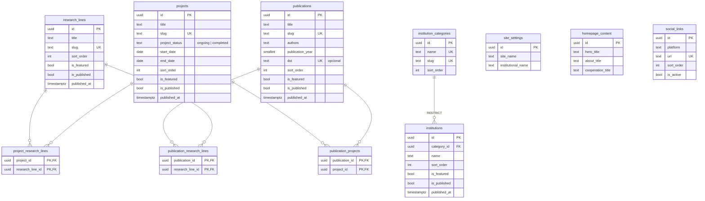

# Modelo de dados — GeoLogar

Schema do banco PostgreSQL (Supabase) que sustenta o conteúdo institucional do
portal. A fonte de verdade é a pasta [`supabase/migrations/`](../supabase/migrations/);
este documento descreve o estado definido por:

- `20261103141529_initial_geologar_content_schema.sql` (conteúdo)
- `20261103190445_admin_memberships.sql` (autorização administrativa)

As migrations `20261103154631_initial_homepage_content.sql` e
`20261103183909_homepage_links_to_internal_pages.sql` apenas inserem e ajustam
dados, sem alterar a estrutura.

Toda alteração estrutural deve ser feita por uma nova migration. Não altere o
banco remoto manualmente pelo painel do Supabase.

## Visão geral

| Tabela                       | Tipo              | Visibilidade pública                     |
| ---------------------------- | ----------------- | ---------------------------------------- |
| `site_settings`              | Singleton         | Sempre                                   |
| `homepage_content`           | Singleton         | Sempre                                   |
| `research_lines`             | Conteúdo editorial | `is_published = true`                   |
| `projects`                   | Conteúdo editorial | `is_published = true`                   |
| `publications`               | Conteúdo editorial | `is_published = true`                   |
| `institutions`               | Conteúdo editorial | `is_published = true`                   |
| `institution_categories`     | Classificação     | Sempre                                   |
| `social_links`               | Configuração      | `is_active = true`                       |
| `project_research_lines`     | Relação N:N       | Quando os dois lados estão publicados    |
| `publication_projects`       | Relação N:N       | Quando os dois lados estão publicados    |
| `publication_research_lines` | Relação N:N       | Quando os dois lados estão publicados    |
| `admin_memberships`          | Autorização       | Nunca (cada usuário lê só o próprio registro) |

## Diagrama relacional



Navegação possível sem duplicar registros:

```
Linha de pesquisa ─┬─ Projetos     (project_research_lines)
                   └─ Publicações  (publication_research_lines)

Projeto ───────────┬─ Linhas de pesquisa (project_research_lines)
                   └─ Publicações        (publication_projects)

Publicação ────────┬─ Projetos           (publication_projects)
                   └─ Linhas de pesquisa (publication_research_lines)

Categoria ─────────── Instituições       (institutions.category_id)
```

## Tabelas

### `site_settings`

Configurações institucionais gerais (nome, contato, endereço, logotipo). Registro
único, garantido pelo índice `site_settings_singleton`. Informações de contato
ficam aqui; não há tabela de contato separada.

A migration insere o único registro com os dados confirmados:
`site_name = 'GeoLogar'` e
`institutional_name = 'Rede de Pesquisa em Geociências — Recursos Naturais e Sustentabilidade'`.
Os demais campos permanecem `NULL` até serem confirmados.

### `homepage_content`

Textos e chamadas dos blocos fixos da homepage (hero, sobre, cooperação) em
colunas estruturadas, não em JSON. Registro único (`homepage_content_singleton`).
Todos os campos aceitam `NULL`. A tabela nasce vazia.

### `research_lines`

Linhas de pesquisa. `slug` único. Nasce vazia — as linhas previstas serão
cadastradas quando o conteúdo for validado.

### `projects`

Projetos de pesquisa. `project_status` aceita `ongoing` ou `completed` via
constraint `projects_status_check` (para novos status, altere apenas essa
constraint numa nova migration). `end_date` não pode ser anterior a
`start_date`. As linhas de pesquisa ficam em `project_research_lines`, não
nesta tabela.

### `publications`

Publicações científicas.

- `title` no idioma original da publicação.
- `authors`: texto no formato de citação, autores separados por `; `
  (ex.: `Silva, A.; Souza, B.`). Não há tabela de autores nesta fase.
- `publication_year`: entre 1800 e 2100, opcional.
- `doi`: opcional, sem prefixo de URL (ex.: `10.1234/abcd.5678`); único sem
  diferenciar maiúsculas/minúsculas.

### `institution_categories`

Categorias de instituições parceiras. `name` e `slug` únicos. Nasce vazia.

### `institutions`

Instituições parceiras. `category_id` é obrigatório e usa `ON DELETE RESTRICT`:
uma categoria só pode ser excluída depois que suas instituições forem movidas ou
excluídas. Localização (`city`, `state`, `country`) é opcional.

### `social_links`

Redes sociais institucionais. `platform` é um identificador em minúsculas
(`instagram`, `youtube`, `linkedin`…). `url` é única. Só aparece publicamente
com `is_active = true`.

### `admin_memberships`

Vínculo administrativo de uma conta do Supabase Auth. Sem registro (ou com
`is_active = false`) a conta não acessa `/admin`. Detalhes de uso em
[`admin-auth.md`](admin-auth.md).

| Coluna       | Tipo          | Regra                                                      |
| ------------ | ------------- | ---------------------------------------------------------- |
| `user_id`    | `uuid`        | PK; FK para `auth.users(id)` com `ON DELETE CASCADE`        |
| `role`       | `text`        | `admin` ou `editor` (constraint `admin_memberships_role_check`) |
| `is_active`  | `boolean`     | Padrão `true`; `false` suspende o acesso sem apagar a conta |
| `created_at` / `updated_at` | `timestamptz` | Padrão `now()`; trigger `set_updated_at`      |

- Índice parcial `admin_memberships_active_role_idx` em `role` (apenas ativos).
- O papel vem sempre desta tabela — nunca de `user_metadata`, que o próprio
  usuário pode alterar.
- A migration não cria registros: o primeiro administrador é vinculado
  manualmente (ver [`admin-auth.md`](admin-auth.md#criar-o-primeiro-administrador)).

### Relações N:N

`project_research_lines`, `publication_projects` e `publication_research_lines`
usam chave primária composta pelos dois IDs, mais `created_at`. As FKs usam
`ON DELETE CASCADE`: excluir uma entidade remove apenas os **vínculos**, nunca a
entidade do outro lado. Há índice no segundo ID de cada relação (o primeiro é
coberto pela PK).

## Regras de conteúdo

### Publicação

Entidades editoriais (`research_lines`, `projects`, `publications`,
`institutions`) usam:

- `is_published` (padrão `false`): o conteúdo só é público quando `true`.
- `published_at`: preenchido automaticamente na primeira publicação, se vazio
  (trigger `set_published_at`). Pode ser definido manualmente.

Não há outros estados editoriais nesta fase.

### Destaques e ordenação

`is_featured` indica presença na homepage e `sort_order` (padrão `0`) controla a
posição, em ordem crescente. Usados em linhas de pesquisa, projetos, publicações
e instituições; `sort_order` também existe em categorias e redes sociais.

### Slugs

Obrigatórios e únicos em `research_lines`, `projects`, `publications` e
`institution_categories`. O banco valida o formato: apenas `a-z`, `0-9` e
hífens simples entre palavras (`^[a-z0-9]+(-[a-z0-9]+)*$`). A geração do slug
fica a cargo do futuro CMS.

### Imagens

Caminhos de imagem (`image_path`, `hero_image_path`, `logo_path`) exigem o
texto alternativo correspondente (`image_alt`, `hero_image_alt`, `logo_alt`).
O upload (Supabase Storage) ainda não foi implementado.

### URLs

Campos de URL externa (`external_url`, `website_url`, `social_links.url`)
precisam começar com `http://` ou `https://`. Os campos `*_cta_href` da homepage
aceitam também caminhos internos (ex.: `/projetos`) e não são validados.

### Datas

Todas as tabelas têm `created_at` (relações N:N só `created_at`) e
`updated_at`, ambos `timestamptz` com padrão `now()`. A função compartilhada
`public.set_updated_at()` atualiza `updated_at` em todo `UPDATE`, via trigger
`set_updated_at` em cada tabela.

## Segurança

### Row Level Security

RLS está habilitado em **todas** as 12 tabelas. Existem apenas políticas de
`SELECT`. Nas 11 tabelas de conteúdo, para os papéis `anon` e `authenticated`:

| Tabela                                       | Condição de leitura                      |
| -------------------------------------------- | ---------------------------------------- |
| `site_settings`, `homepage_content`, `institution_categories` | sempre                   |
| `research_lines`, `projects`, `publications`, `institutions`  | `is_published`           |
| `social_links`                               | `is_active`                              |
| tabelas N:N                                  | as duas entidades vinculadas publicadas  |

Em `admin_memberships`, apenas `authenticated` tem `SELECT`, com a política
*"Users can read their own admin membership"* (`auth.uid() = user_id`); `anon`
não tem nenhum privilégio.

### Escrita

Nenhuma escrita é permitida para `anon` ou `authenticated`:

- não há políticas de `INSERT`, `UPDATE` ou `DELETE`;
- além disso, os privilégios de escrita desses papéis foram revogados
  (apenas `SELECT` é concedido).

Somente `service_role` (que ignora RLS) pode escrever, e essa chave deve ser
usada exclusivamente em código de servidor. O mesmo vale para
`admin_memberships`: nenhum usuário cria, altera ou promove o próprio vínculo;
o primeiro administrador é vinculado pelo SQL Editor. As políticas de escrita
do conteúdo serão criadas junto com o CMS, a partir do vínculo em
`admin_memberships`.

As funções de trigger usam `search_path` vazio e não podem ser executadas
diretamente por `anon`/`authenticated`.

## Ainda não implementado

- Políticas de escrita no conteúdo (CMS) e gestão de usuários pelo painel.
- Supabase Storage (buckets e políticas de arquivos).
- Tabela de autores de publicações.
- Formulário de contato (mensagens recebidas).
- Conteúdo inicial: linhas de pesquisa, categorias, instituições, projetos,
  publicações, redes sociais e textos da homepage.
