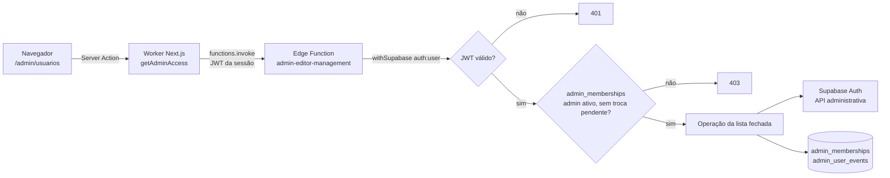

# Gerenciamento de Editores (Etapa 10.5)

O Administrador cria e gerencia contas de **Editor** pelo próprio painel, em
**Configurações → Usuários e permissões** (`/admin/usuarios`), sem convite por
e-mail, link de ativação ou SMTP. A pessoa entra com o e-mail e a senha inicial
cadastrados e precisa trocar a senha no primeiro acesso.

O primeiro Administrador continua sendo criado de forma excepcional, pelo
painel do Supabase (ver [`admin-auth.md`](admin-auth.md#criar-o-primeiro-administrador)).
Administradores não são criados, promovidos nem alterados por este módulo.

## Arquitetura



| Peça | Onde | Papel |
|---|---|---|
| Página `/admin/usuarios` | `src/app/admin/(protected)/usuarios/page.tsx` | Lista, filtros, busca, paginação e histórico; só para admin (verificado no servidor) |
| Diálogos | `src/components/admin/users/editor-dialogs.tsx` | Adicionar Editor, desativar/reativar, definir nova senha inicial |
| Troca obrigatória | `src/app/admin/(auth)/trocar-senha-inicial/page.tsx` + `initial-password-form.tsx` | Formulário “Defina sua senha pessoal” |
| Server Actions | `src/lib/admin/user-actions.ts` | Conferem sessão e papel; chamam a função; nunca guardam senhas |
| Chamada à função | `src/lib/admin/editor-function.ts` | `supabase.functions.invoke` com a sessão do usuário |
| Edge Function | `supabase/functions/admin-editor-management/index.ts` | Valida o JWT, liga o núcleo à API administrativa e ao banco |
| Núcleo (puro) | `supabase/functions/_shared/editor-accounts.ts` | Contrato, validações, autorização e regras de cada operação |
| Migration | `supabase/migrations/20261123150000_editor_account_management.sql` | Troca obrigatória, `has_cms_role`, histórico |

### Por que uma Edge Function

A API `auth.admin` exige a chave secreta do projeto. Ela fica **somente** nos
secrets padrão da Edge Function (`SUPABASE_SECRET_KEYS`, fornecidos pela
plataforma): não está no Worker, no navegador, no Git nem em arquivos `.env*`
que o build do OpenNext incorporaria. O Worker só repassa o JWT da sessão.

### Autenticação da função

- `verify_jwt = true` (`supabase/config.toml`, `[functions.admin-editor-management]`):
  a plataforma recusa chamadas sem JWT válido.
- `withSupabase({ auth: "user", cors: "disabled" })` de `npm:@supabase/server`
  (padrão atual da documentação do Supabase) valida de novo o JWT e expõe
  `ctx.userClaims` e o cliente administrativo `ctx.supabaseAdmin`. Chave
  publicável sozinha, JWT forjado ou ausente → **401**.
- O núcleo consulta o vínculo atual em `admin_memberships` antes de qualquer
  operação. Falha nessa consulta → erro, nunca acesso.
- Não confia em papel enviado pelo navegador, `user_metadata` nem no cookie
  `geologar-editor` (indicador visual).

## Operações (lista fechada)

| Operação | Quem | O que faz |
|---|---|---|
| `list-editors` | admin ativo | Editores (e contas criadas pelo módulo com configuração incompleta), filtro, busca e página de 20; últimos 15 eventos |
| `create-editor` | admin ativo | Cria a conta no Auth (`email_confirm: true`) e o vínculo `editor` com troca obrigatória |
| `deactivate-editor` / `reactivate-editor` | admin ativo | `is_active` do vínculo de um **Editor** |
| `reset-editor-password` | admin ativo | Nova senha inicial de um **Editor** e nova exigência de troca |
| `complete-initial-password` | a própria conta | Troca a senha inicial e libera o acesso |

Qualquer outro nome de operação ou campo fora do contrato → `400`. O papel das
novas contas é sempre `editor`, definido no servidor. Não há exclusão de
contas, promoção, alteração de administradores nem do próprio administrador
(`not-editor` / `forbidden`). Limite: 30 operações por administrador por hora;
10 tentativas de troca malsucedidas por conta por hora.

## Criação de Editor

1. Validação no navegador, na Server Action e no núcleo: e-mail (sem espaços
   nas extremidades, minúsculas), senha forte e confirmação igual.
2. Busca o e-mail nas contas do Auth:
   - **Editor ativo** → “Este e-mail já pertence a um Editor ativo.” (senha não muda);
   - **Editor desativado** → mensagem e indicação de usar “Reativar acesso”;
   - **Administrador** → bloqueado;
   - **conta do Auth sem vínculo** criada por outro caminho → não é alterada
     nem vinculada (“requer verificação administrativa”); a associação é feita
     pela equipe técnica, como no bootstrap, sem trocar a senha da pessoa;
   - **conta criada por este módulo sem vínculo** (falha parcial anterior,
     marcada com `app_metadata.geologar_managed`) → a nova tentativa define a
     senha inicial informada e conclui o vínculo, sem duplicar a conta.
3. `auth.admin.createUser({ email, password, email_confirm: true, app_metadata })`.
   `email_confirm: true` confirma o endereço administrativamente: **não há
   prova técnica** de que o e-mail pertence à pessoa, por isso o Administrador
   confirma a identidade antes de criar a conta.
4. Vínculo `role = 'editor'`, `is_active = true`, `must_change_password = true`
   e `password_change_required_at`.
5. Evento `editor_created` no histórico.

Falha no vínculo depois da criação no Auth: a tela **não** informa sucesso, a
conta não acessa o CMS (sem vínculo), o evento registra a falha e a lista
mostra “Configuração incompleta”. Repetir “Criar Editor” com o mesmo e-mail
conclui o cadastro.

## Primeiro acesso e troca obrigatória

- Login normal em `/admin/login`. Com `must_change_password = true`,
  `resolveAdminAccess` devolve `forbidden` com motivo `password-change` e
  todas as páginas (`requireAdminAccess`) levam a `/admin/trocar-senha-inicial`.
- O bloqueio não é só visual:
  - **Server Actions** do CMS recusam a conta (`forbidden`);
  - **banco**: `has_cms_role` exige `not must_change_password`, então RLS,
    RPCs do fluxo editorial, Storage (biblioteca de mídia) e a policy da
    homepage recusam a conta;
  - **Edge Function**: operações administrativas → `password-change-required`.
- A conta lê o próprio vínculo (necessário para a tela), mas não tem
  `UPDATE` em `admin_memberships`: não consegue remover a exigência pela API.

Conclusão (`complete-initial-password`):

1. A nova senha passa pela política e precisa ser **diferente** da inicial
   (conferida com uma entrada descartável no Auth, encerrada em seguida).
2. `auth.admin.updateUserById(id, { password, app_metadata: { geologar_password_changed_at } })`
   — a troca e o marcador são gravados juntos no Auth. O Auth encerra as
   sessões da conta; a Server Action entra de novo com a nova senha.
3. `must_change_password = false` no vínculo e evento `initial_password_changed`.

Falhas parciais (não há atomicidade entre Auth e PostgreSQL):

| Falha | Resultado |
|---|---|
| Auth recusa a troca | Nada muda; exigência mantida; mensagem para tentar de novo |
| Banco falha depois da troca | Acesso continua bloqueado; mensagem “Sua senha foi alterada, mas o acesso ainda não foi liberado…”. Na nova tentativa, o marcador no Auth posterior à exigência atual conclui a liberação sem pedir a senha antiga |
| Marcador antigo (anterior à exigência atual) | Não libera nada; a troca é exigida de novo |

## Desativar, reativar e redefinir

- **Desativar**: `is_active = false`. Conta do Auth, conteúdos, histórico de
  versões, mídias e autoria são preservados. Vale na requisição seguinte,
  inclusive com sessão antiga ainda válida (painel e banco consultam o vínculo
  a cada operação).
- **Reativar**: `is_active = true`. A troca de senha pendente continua exigida.
- **Definir nova senha inicial**: primeiro grava a exigência de troca
  (`must_change_password = true`), depois altera a senha no Auth. Se o Auth
  falhar, a conta fica bloqueada até a pessoa definir uma senha própria (lado
  seguro). O Supabase Auth encerra as sessões ao alterar a senha; mesmo um
  token de acesso ainda não expirado não edita nada enquanto a troca estiver
  pendente.

## Histórico (`admin_user_events`)

Tipos: `editor_created`, `editor_deactivated`, `editor_reactivated`,
`editor_password_reset`, `initial_password_changed`; resultado `success` ou
`failure`; `detail` aceita apenas códigos curtos (constraint). Registra quem
fez, a conta alvo, o e-mail alvo e a data. **Nunca** senhas nem tokens.

- Leitura: administradores ativos (RLS) e a Edge Function.
- Escrita: somente `service_role` (Edge Function), apenas `INSERT`.
- Ninguém altera nem exclui eventos (sem `UPDATE`/`DELETE`, nem para o
  `service_role`).

## Senhas

- Tratadas exclusivamente pelo Supabase Auth. Nenhuma coluna de senha ou hash
  nas tabelas do CMS; nada em `localStorage`, URL, logs, analytics, mensagens
  de erro ou e-mail.
- Política: ≥ 8 caracteres, ≤ 72 bytes, três de quatro tipos (minúscula,
  maiúscula, número, símbolo), sem o nome do e-mail. O Auth aplica também a
  configuração do projeto.
- A senha inicial não é exibida depois do cadastro. O Administrador a
  transmite por um canal seguro e separado.

## Testes

| Camada | Arquivo | Cobertura |
|---|---|---|
| Núcleo (sem rede) | `tests/admin/editor-accounts.test.ts` | 31 testes: validação, operações fora da lista, editor/inativo/sem vínculo recusados, falha de banco sem acesso, criação, e-mail duplicado, conta preexistente, erro do Auth, falha de vínculo e recuperação sem duplicar, limite, listagem, desativar/reativar, administradores protegidos, redefinição (com falha do Auth), troca obrigatória (igual à inicial, fraca, falha do Auth, falha do banco e nova tentativa, marcador antigo) |
| Banco (pgTAP) | `supabase/tests/database/editor_account_management.test.sql` | 30 testes: `has_cms_role` com troca pendente, RLS/RPC/Storage bloqueados, a conta não remove a exigência, editor não altera papel nem vínculos, histórico só leitura para admin e append-only |
| E2E visitante | `tests/e2e/visitor.spec.ts` | `/admin/usuarios` e `/admin/trocar-senha-inicial` exigem login |
| Função publicada | `curl` | sem credenciais, só chave publicável ou JWT forjado → 401 |

Fluxos com contas reais (criar, primeiro acesso, desativar, redefinir) são
feitos por uma pessoa autorizada no navegador; ver
[`homologation-checklist.md`](homologation-checklist.md).

## Deploy

A Edge Function **não** é publicada pelo push no GitHub (o Workers Builds
publica só o Worker):

```bash
npx supabase db push --remote                     # migrations novas
npx supabase functions deploy admin-editor-management --use-api
npx supabase functions list                       # verify_jwt: true, ACTIVE
```

Nenhum secret adicional é necessário: `SUPABASE_URL`,
`SUPABASE_PUBLISHABLE_KEYS` e `SUPABASE_SECRET_KEYS` são fornecidos pela
plataforma. Verificação de tipos local: `deno check --no-lock
--node-modules-dir=none supabase/functions/admin-editor-management/index.ts`.
